# Compte rendu — Inversion de contrôle et injection des dépendances

**Étudiant :** CHAKRANI Ilyass — École d'Ingénierie de Mundiapolis (cycle ingénieur 2A)
**Sujet :** Application « fermée à la modification et ouverte à l'extension » : couplage faible + injection des dépendances (statique, dynamique, Spring XML, Spring annotations)
**Source :** vidéos de cours sur l'injection des dépendances (exemple DAO / Métier / Présentation)

---

## 1. Objectif

Montrer comment créer une application Java **fermée à la modification** et **ouverte à l'extension**, ce qui facilite la maintenance. Cela repose sur deux principes :

1. **Le couplage faible** : dépendre des *interfaces* et non des *classes* (« programmer des interfaces, pas des implémentations »).
2. **L'injection des dépendances** : un objet reçoit les objets dont il a besoin au lieu de les créer lui-même (par `new`).

Dans une application basée sur l'**inversion de contrôle** (IoC), le développeur se concentre sur le code **métier** ; le framework (Spring) s'occupe du code **technique** : création des objets, injection, transactions, sécurité, journalisation…

## 2. Architecture du projet

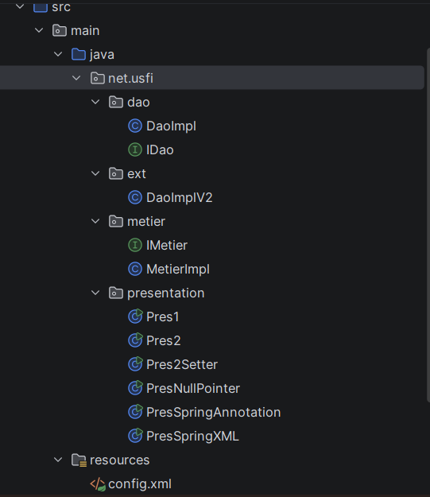

## 3. Partie 1 — Réalisation

### Étape 1 — Interface `IDao` avec la méthode `getData`

Le **concepteur** crée l'interface : il définit ce qui doit être implémenté.

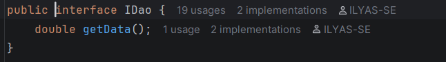

### Étape 2 — Implémentation de `IDao`

Le **développeur** implémente le besoin. Ici, la « version base de données » : pas de vraie base, on affiche un message et on retourne une température.

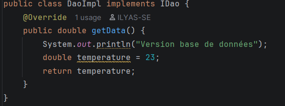

Une seconde implémentation (`DaoImplV2`, « version capteur », température 12) est ajoutée dans le package `ext` pour simuler une évolution demandée plus tard par le client.

> On dit « je crée **une** implémentation de l'interface » (et non « *l'*implémentation ») : une interface sert justement à permettre plusieurs implémentations dans le futur.

### Étape 3 — Interface `IMetier` avec la méthode `calcul`

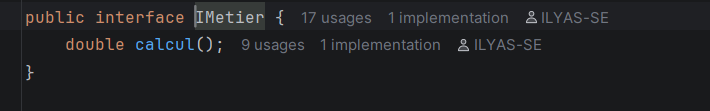

### Étape 4 — Implémentation de `IMetier` avec couplage faible

`MetierImpl` dépend de l'**interface** `IDao` et non d'une classe. L'attribut n'est **pas initialisé** (valeur `null` par défaut) : écrire `= new DaoImpl()` créerait un couplage fort.

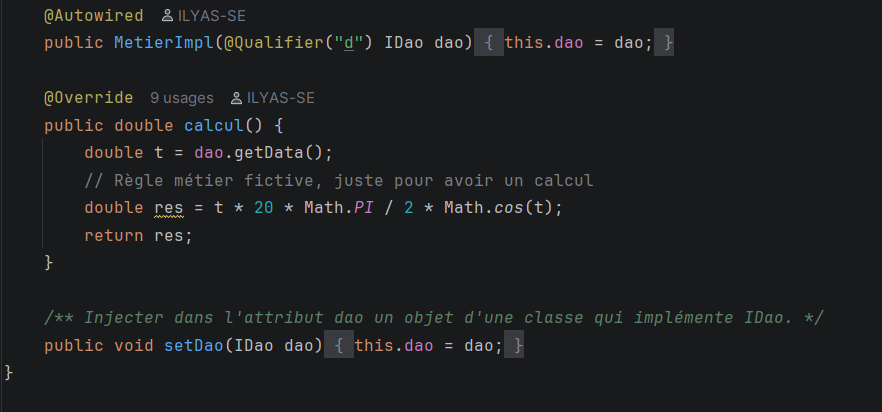

Tant que `dao` n'est pas injecté, l'appel de `calcul()` provoque une **`NullPointerException`** (« dépendance non satisfaite », voir `PresNullPointer`) :

```
Exception in thread "main" java.lang.NullPointerException:
Cannot invoke "net.usfi.dao.IDao.getData()" because "this.dao" is null
    at net.usfi.metier.MetierImpl.calcul(MetierImpl.java:34)
```

Deux moyens d'injecter : le **setter** (constructeur sans paramètres puis `setDao`) ou le **constructeur avec paramètres** (en une seule opération, à l'instanciation). Le constructeur est préféré dans la pratique.

### Étape 5 — Injection des dépendances

#### a) Par instanciation statique (`Pres1`)

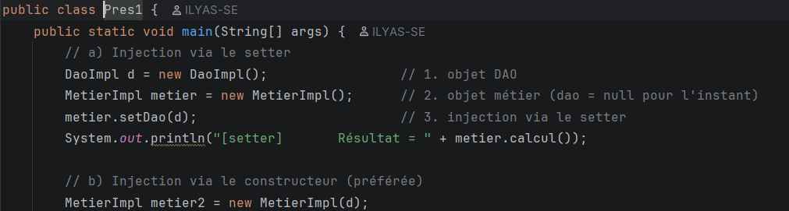

Sortie obtenue :

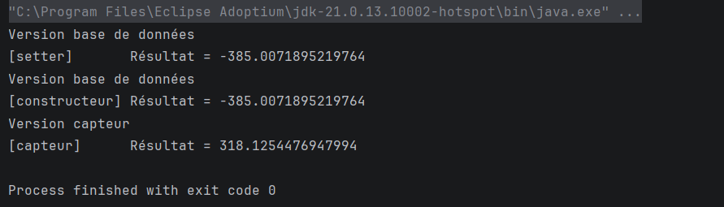

**Analyse :**
- Couche DAO : fermée à la modification (elle ne dépend d'aucune classe) et ouverte à l'extension (interface).
- Couche métier : fermée à la modification (elle ne dépend que d'interfaces) et ouverte à l'extension.
- Couche présentation : **encore ouverte à la modification**. Pour passer de `DaoImpl` à `DaoImplV2`, il faut changer le code source (`new DaoImplV2()`) et recompiler. Cette classe est une *fabrique* (factory) : la maintenance est au moins concentrée sur une seule classe.

#### b) Par instanciation dynamique (`Pres2`, `Pres2Setter`)

Fichier `config.txt` (à la **racine** du projet, pas dans `src`) :

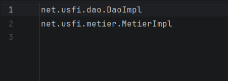

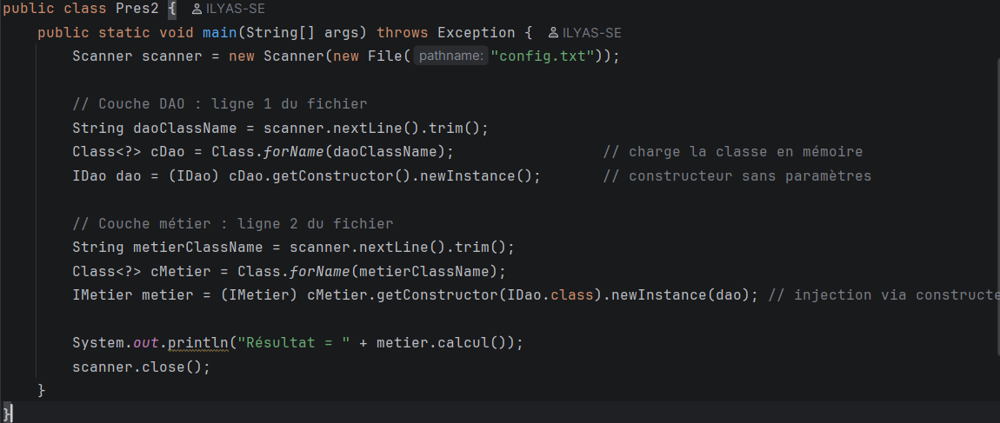

Variante par le setter (`Pres2Setter`), via la réflexion :

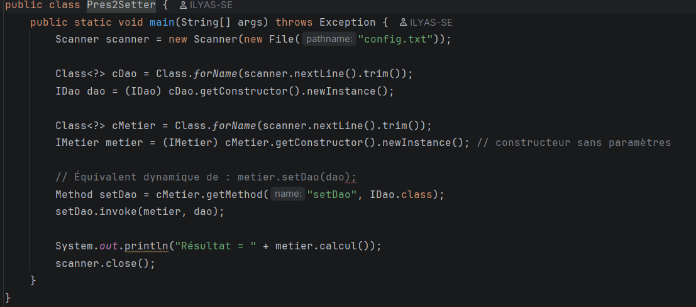

Sortie obtenue avec `config.txt` ci-dessus :

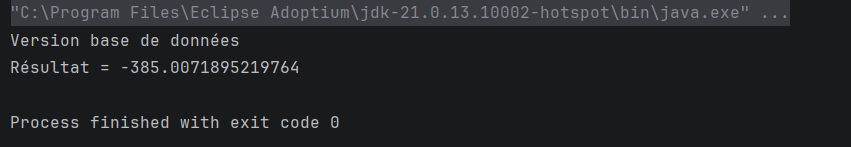

Pour basculer vers la version capteur, on modifie **uniquement** `config.txt` (`net.usfi.ext.DaoImplV2` en ligne 1), sans toucher au code :

```
Version capteur
Résultat = 318.1254476947994
```

La couche présentation devient donc **fermée à la modification et ouverte à l'extension**. Exceptions classiques rencontrées avec la réflexion : `ClassNotFoundException` (nom de classe/package mal écrit), `InstantiationException`, `IllegalAccessException` (constructeur privé), `NoSuchMethodException`, `InvocationTargetException`.

**Limite :** il faut trois lignes pour créer un objet, et le code se répète (copier-coller-remplacer). Quand on en arrive là, c'est qu'un framework existe déjà : **Spring**.

#### c) Avec le framework Spring

Dépendances Maven (`pom.xml`) : `spring-core`, `spring-context`, `spring-beans` (version 6.2.3).

**Version XML** (`PresSpringXML`, fichier `src/main/resources/config.xml`) :

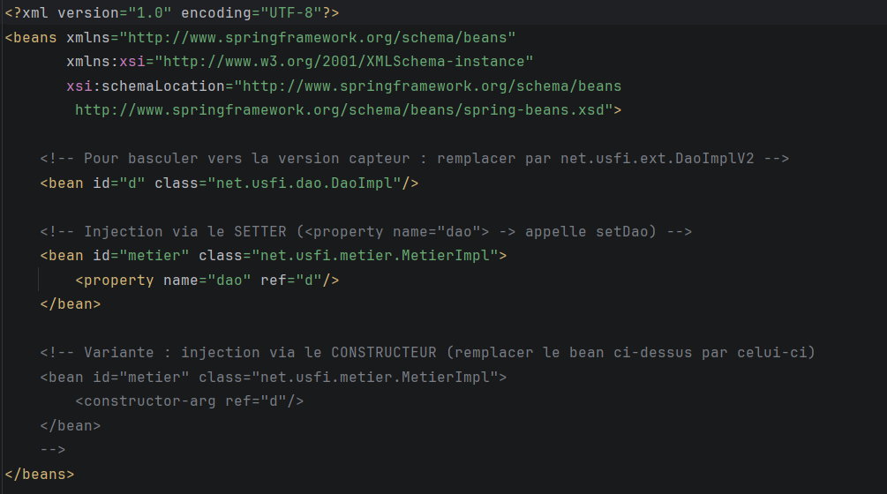

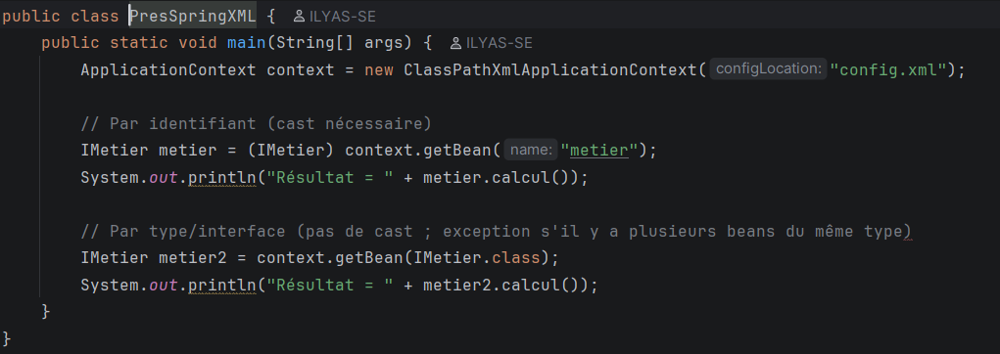

Au démarrage, Spring lit le XML, crée les objets (beans), les stocke dans son contexte (une map nom → objet) et fait l'injection. Pour injecter via le constructeur, on remplace `<property>` par `<constructor-arg ref="d"/>`. Pour passer à la version capteur, on remplace la classe du bean `d` par `net.usfi.ext.DaoImplV2`.

**Version annotations** (`PresSpringAnnotation`) :

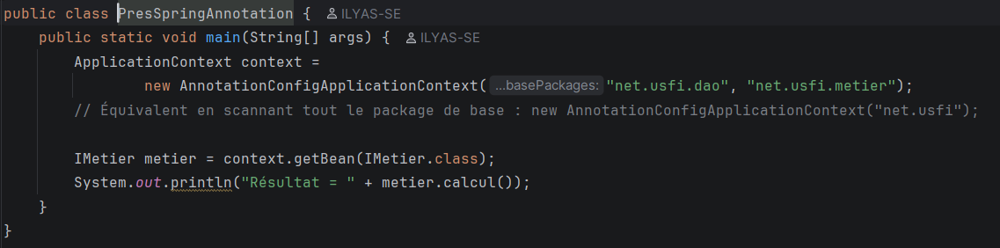

Points importants :
- `@Component` demande à Spring d'instancier la classe et de l'enregistrer comme bean ; `@Autowired` demande l'injection automatique (sur l'attribut ou sur le constructeur).
- Spring **scanne** les packages indiqués. Avec un package de base (`"net.usfi"`), il scanne tous les sous-packages.
- S'il existe **plusieurs beans** du même type (ex. `d` et `d2`), Spring lève `NoUniqueBeanDefinitionException` / `UnsatisfiedDependencyException` : il faut préciser le bean avec `@Qualifier("d")` ou `@Qualifier("d2")`. La valeur du qualifier pourra plus tard venir d'un fichier de configuration (`application.properties` avec Spring Boot).
- Spring propose des annotations spécialisées : `@Repository` (couche DAO), `@Service` (couche métier), `@Controller` (couche web).

## 4. Tableau récapitulatif

| Technique | Qui crée les objets ? | Changer de version du DAO | Couche présentation fermée à la modification ? |
|---|---|---|---|
| Instanciation statique (`new`) | Le développeur | Modifier le code source | Non |
| Instanciation dynamique (réflexion) | Le développeur (code générique) | Modifier `config.txt` | Oui |
| Spring XML | Spring | Modifier `config.xml` | Oui |
| Spring annotations | Spring | `@Qualifier` / packages scannés | Oui |

## 5. Conclusion

Pour créer une application fermée à la modification et ouverte à l'extension, il faut (1) utiliser le **couplage faible** (dépendre des interfaces) et (2) faire l'**injection des dépendances**. Avec Spring, ce n'est plus le développeur mais le framework qui crée et contrôle les objets, d'où le nom d'**inversion de contrôle** : le développeur écrit le code métier, Spring gère le code technique. Dans la pratique, on préfère les **annotations** au XML, et l'injection par le **constructeur** à celle par le setter.
